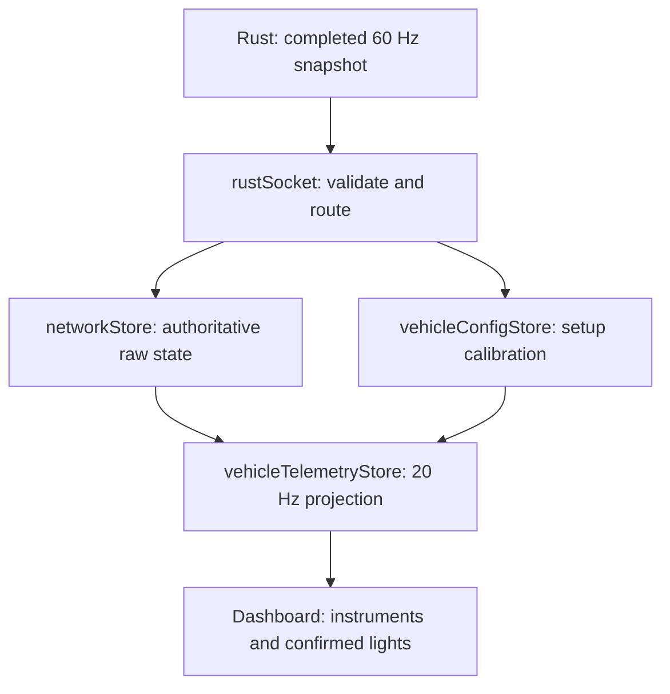

# Store ownership and update rates

Stores separate received simulation state, requested input, sampled display data,
menus and device preferences. A store notification is not automatically a React
render: a selector renders only when its selected value changes. Prefer direct
imports and narrow selectors. Frame/transport loops read `getState()` or refs.

## Data flow

Keyboard/gamepad/touch actions write `inputStore`; its merged `inputRef` is read
by one 60 Hz sender. Rust samples held input on its fixed tick and runs 120 Hz
physics substeps. Gauges never write physics state. Changing a display unit does
not change what Rust receives.

## Reference

Rates are foreground scheduling targets, not measured guarantees. Browser
throttling, network delay and server overload can reduce actual delivery rates.
Event-driven stores have no fixed Hz.

| Store / state | Responsibility | Writer / target frequency | Lifetime / consumers |
| --- | --- | --- | --- |
| `networkStore.ts` | Connection, identity, latest raw snapshot, local compatibility `physicsData`, RTT and debug envelope | Socket: normally 60 snapshots/s; requested debug at most once per published tick; RTT ping every 5 seconds; setup events | Session-local, reset on teardown. Raw rendering/interpolator, diagnostics, HUD sampler. |
| `vehicleConfigStore.ts` | Gauge calibration by player ID, explicit telemetry availability | `vehicle_config` on spawn/change; no per-frame writes | Cleared with session. HUD sampler only. Bad config leaves previous valid data. |
| `vehicleTelemetryStore.ts` | Local player's sanitized HUD readings, position/yaw and live/waiting/stale/offline state | One shared 20 Hz sampler only while HUD or cockpit mounted and tab visible; unchanged display values do not publish | Dashboard and Cockpit. No persistence or input/physics ownership. Stale after 500 ms without a fresh snapshot. |
| `navigationStore.ts` | Local GPS destination; static road graph is derived from `worldStore.map` | User waypoint/clear actions only; no timer or sender | Session-local. Minimap only. |
| `inputStore.ts` / `inputRef` | Requested axes/masks and derived pedal signals, merged by source | Keyboard/touch events; gamepad polls at display refresh. Identical writes are ignored. Sender independently reads at 60 Hz | Runtime intent. Transient holds release on lifecycle/focus transitions. Confirmed values remain in network telemetry. |
| `uiStore.ts` | Screen/overlay, selected menu rows, loading and selected recon mission | Navigation/loading/user events | Application/menu composition. No snapshot writes or persistence. |
| `gameStore.ts` | Camera/editor controls and legacy game settings | Camera/editor actions; legacy RotatingCamera has a frame-rate angle writer when mounted/active | Camera/render helpers. Active routing is uiStore, pre-game selection is selectionStore. |
| `worldStore.ts` | Map/collider metadata, debug request mask, legacy render mode/switches | Map/setup events and debugger actions; sender reads debug mask each send | City/collider rendering and capture context. Static colliders are sent with map setup. |
| `renderSettingsStore.ts` | Graphics quality/range/effects and per-object overrides | User presets/settings and sandbox entry | Renderers/menus. Validated display choices persist; session overrides do not. |
| `preferencesStore.ts` | Key bindings, sensitivity/deadzone, accessibility, favorites, units, driving layout, shifter presentation, independent HUD visibility and wheel crop/travel | User actions / validated local-storage hydration | Device-local persistence. No physics values. |
| `debugViewStore.ts` | Interpolation preference and diagnostic player scope | User actions | Interpolation persists (default On, 50 ms buffer); scope is session-local. |
| `visualAlignmentStore.ts` | Measured GLB alignment reports | Model measurement/mount/unmount events | Rendering alignment and capture metadata. |
| `selectionStore.ts` | Vehicle/map catalogs and selected indexes | Selector actions | Garage/setup. Catalog imports render components; avoid its barrel in hot or transport code. |
| `canBusStore.ts` | Recon interface/mode and last CAN service status | User actions / explicit `refreshStatus()` request; no internal polling timer | Recon setup/header; separate from Rust physics. |
| `canDataStore.ts` | Command panel, CAN frames/logs, playback cursor and volatility | CAN/import/playback/UI events; no fixed Hz | CAN views. Raw logs/frames still need a separate bounded retention policy. |
| `signalReconStore.ts` | CAN identity, protocols, mission/session/marker workflow | Async data-service responses and mission actions; mission component uses its own 20 Hz display clock | Recon only; existing protocol preferences use their saved format. |
| `performance/captureSettingsStore.ts` | Capture name, duration and next-baseline choice | User actions | Device-local persistence. |
| `performance/performanceOverlayStore.ts` | Compact/expanded state, tab and controller focus | Shortcuts/navigation | Runtime overlay and input routing. |
| `performance/measurements.ts` (plain recorder) | Bounded metric rings, captures, timeline and archive notifications | Numeric samples at frame/packet/tick rates; visible summary at 4 Hz | Compact mode skips hidden summaries. Archive writes on capture completion/clear, never per frame. |

## Input ownership

Sources are `keyboard`, `gamepad`, `touch-steering`, `touch-throttle`,
`touch-pedals`, `touch-actions`. Use `setAnalogFromSource`, held-flag actions and
`releaseInputSource`. A nonzero keyboard axis wins conflicts, then touch, then
gamepad; brake/handbrake intent combines by maximum. An idle gamepad cannot erase
a pedal, and releasing a joystick cannot clear another device or brake button.

`releaseControls()` clears transient axes/held flags but preserves deliberate
engine/light/assist settings. `setInput` / `setAnalog` remain compatibility APIs;
new producers use source-aware actions. Never mutate `inputRef`. The sender reads
the latest merged intent and skips queued repeats when the socket is congested.
The handbrake field now drives the rear cable brake in Rust. `cockpit_mask` adds
stepped latched parking, assisted gear selection, stalk modes, cruise and FR-S assist requests
without another socket writer. Optional v3 `cabin_mask` adds packed key/HVAC
requests with an explicit key-command marker so a temperature change cannot replay
START. Confirmed `cabin_mask` and `cruise_target_kph` use the same 20 Hz projection. The open cockpit also owns the shared 20 Hz
telemetry sampler, so acknowledgements continue while the driving HUD is hidden.
See [cockpit protocol](../../../docs/COCKPIT_UI.md). `radioStore` is event-driven
and owns one local Audio element plus a bounded 100-file local queue; it sends no audio bytes to Rust and persists no
selected file. Protocol v4 command 11 is a temporary forward gear override; the server resumes
automatic shifts after 0.75 loaded seconds; idle gear taps wait for throttle. Presentation choices and hiding groups never write
a gear or engine request. Chat is a disconnected channel shell, not another
simulation/network store. v5 extends `cabin_mask` to u32 with airflow bits16–18
and fan4 bit19; ambient °C comes once in vehicle configuration and displays °F.
Inspection actions preserve/restore diagnostic state and release input; physical
server tuning remains read-only. `cabinClock.ts` owns one visible-only 30-second local-clock timer shared by the
gear display and climate strip. It has no per-frame writer. A future server-owned
`match_clock` is displayed separately when supplied; the client creates no match timer.

Requested `vehicleMask` is not confirmed `vehicle_mask`. Dashboard ABS/TCS lights
follow server snapshots; a dashed light means the requested bit awaits confirmation.
The optional right-hand console and Cockpit → Drive share the same
assist controls, including controller A/Cross access. Their current choices are
runtime requests. Controller layout and the independent touch/Drive visibility
preferences persist; changing either layout never disables keyboard/gamepad input.

## Units, flags and resource state

Raw speed is m/s. The HUD projects `speedKph` once, then optionally displays MPH.
RPM is revolutions/min, fuel liters, temperature Celsius, engine torque N·m,
condition, NOS and ultimate fractions are 0..1. Rust owns fuel, heat, wear, NOS
and damage-dealt ultimate charge. Ultimate never derives from own condition loss.
The new `powertrain.rs` advances once per substep using seconds, not frame counts.

There are three distinct mask domains:

| Mask | Values / meaning |
| --- | --- |
| Vehicle/player input and confirmed state | Existing u16 flags; vehicle bits 0..7 are engine, headlights, left/right indicators, hazards, ABS, TCS, BOOST. Debug requests use u32. |
| Setup `hud.telemetry_mask` | RPM=1, gear=2, fuel=4, temperature=8, NOS=16, condition=32, ultimate=64. Availability, not an On/Off request. Road cars advertise 127; tank 111 (no NOS). |
| Snapshot `resource_mask` | Starting=1, hot=2, low fuel=4, empty=8, damaged=16, overheat lock=32. Status from the server. |

The wire is JSON with packed boolean flags, not a binary telemetry codec.
`rustSocket` normalizes the boundary; new gauges do not parse packet byte layouts.
Old servers without availability show dashes for placeholder resource values;
real zero fuel becomes empty only when the FUEL bit and capacity are present.
Optional per-entity `telemetry_mask` overrides setup availability; invalid values
disable those readings. Missing/nonfinite values remain unavailable.

## Boundaries and cleanup

Use direct store imports. `store/index.ts` is a compatibility barrel that also
loads selection/render components. New stores are data-only. The new HUD sampler
does not revive the retired monolithic `useStore` / `mutation` system.
`gameStore` still contains old route/selection fields; new code uses uiStore and
selectionStore. Review callers before removing compatibility fields. Future
binary/quantized transport belongs in a versioned socket codec with round-trip
tests, decoded into these same units. See [HUD/resource integration](../../../docs/VEHICLE_HUD.md).

Instrument subscriptions are separate for speed, RPM and fuel/temperature.
Position/yaw projections serve the map without invalidating those components.
Steering axis updates only the rotor; stalk state is memoized separately. Chat's
unused component and saved visibility option were removed. Radio transport and
volume remain event-driven, with no new progress timer or network sender.
